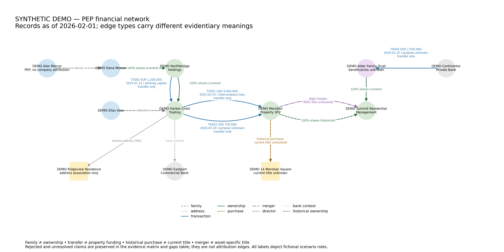

# PEP Financial Network OSINT — synthetic portfolio

An implementation of an evidence-disciplined financial-intelligence workflow. All people, organizations, jurisdictions, assets and records in this project are fictional scenario roles. Name similarities are coincidental. The demo contains no investigative case evidence.

## Purpose and analytic problem

Public-record network analysis can combine distinct propositions into a misleading story. A family link, corporate shareholding, payment, property purchase and merger answer different questions. This project asks: **which entities, flows, assets and intermediaries can be linked, and what supports ownership, control, access, benefit or mere association?**

This is a worked implementation layer, not a universal financial-intelligence methodology or a production screening system.

## Workflow

Requirements → entity resolution → ownership/control → transactions → asset linkage → corporate succession/title → confidence/unknowns → collection gaps.

The [methodology](docs/methodology.md) maps each stage to inputs, controls and outputs. Exact identifiers join records; name similarity never merges entities automatically.

## Evidence model

The claims ledger separates Confirmed, Strongly supported, Probable / analytic judgment, Alleged / unverified, Unresolved and Rejected. Confidence is qualitative and source-bounded. It is neither a legal probability nor a finding. Evidence maturity is separate: Established, Corroborated, Analytic, Experimental and Open dependency. No experimental scoring or weights are implemented.

Sources have canonical record keys and explicit derivative ancestry. S005 summarizes S004; the two remain visible but contribute only one documented lineage root. Documented roots are not proof of independent collection. See [evidence rules](docs/evidence_standards.md).

## Demo and outputs

Dana Mercer has a recorded shareholding; the related fictional PEP Alex Mercer is not attributed that ownership. A USD 4m loan transfer predates a USD 5.5m purchase by 17 days, supporting only a qualified liquidity inference. A merger is established, but A001's later title and the trust beneficiaries remain unresolved. A002 has only a shared registered address.



* [GraphML](outputs/demo_network.graphml): 12 nodes and typed directed multiedges; historical facts remain historical.
* [Evidence matrix](outputs/evidence_matrix.csv): all nine claims, including rejected propositions and alternatives.
* [Unresolved gaps](outputs/unresolved_gaps.csv): title, beneficiary, funding and source-of-funds collection needs.
* [Source dependencies](outputs/source_dependencies.csv): explicit ancestry and context-only derivative records.
* [Clean validation](outputs/validation_clean.json) and [broken validation](outputs/validation_broken.json): machine-readable results.
* [Claims ledger](data/synthetic_claims.csv), [source register](data/synthetic_sources.csv), [data dictionary](docs/data_dictionary.md).

## Guardrails

Family ≠ subject ownership; payment ≠ purchase funding; funding ≠ valuation; offshore ≠ criminality; AML red flag ≠ legal finding; succession ≠ title; negative search ≠ negative proof. Directed edges show the typed relation, never legal responsibility. Open/rejected claims do not become graph attribution edges.

## Reproduce

Use Python 3.14 and an isolated environment. From the repository root:

```console
python -m venv .venv
# Activate .venv using your platform's standard command.
python -m pip install -r requirements.txt
python -m pytest -q
python -m src.validate_data --data data --output outputs/validation_clean.json
python -m src.build_network --data data --output outputs
python -m src.validate_data --data tests/fixtures/broken --output outputs/validation_broken.json
# The last command MUST return exit code 1; all prior commands return 0.
```

The default evidence cutoff is 2026-02-01. [Reproducibility](docs/reproducibility.md) explains input hashes, environment capture, deterministic layout and expected failures. Tests cover all 14 frozen validation requirements, plus structural, lineage and graph regressions.

## Limitations and ethics

Validation checks record structure and explicit evidence categories; it cannot establish document authenticity, real-world truth or the adequacy of collection. The demo uses authored fictional records, not bank or registry access. Unknowns remain unknown. Purchase price is not current market valuation. See [ethics and limitations](docs/ethics_and_limitations.md) and the [hostile review](docs/red_team_review.md).

## Skills demonstrated

Intelligence requirements, OSINT evidence qualification, AML/financial-crime reasoning, due diligence, entity resolution, transaction analysis, network analysis, uncertainty, falsification, reproducible research and stakeholder-ready outputs. This artifact demonstrates intelligence-production skills; it does not claim formal operational intelligence employment.

## Public/private boundary and release

Only synthetic inputs, generalized implementation notes, schemas, code and demo outputs belong here. Private case files, contributor information, calibration materials, real allegations and experimental scoring inputs are excluded. The package is prepared for review. Repository visibility must remain private until the hostile review and final owner approval are complete. No script or workflow changes visibility or publishes releases.

**License:** [MIT License](LICENSE), copyright © 2026 Jason Keen. The license applies to this synthetic portfolio's code, documentation and demonstration material; third-party dependencies retain their own licenses. Licensing is separate from publication: the repository remains private until the owner explicitly approves public visibility after final release review.
