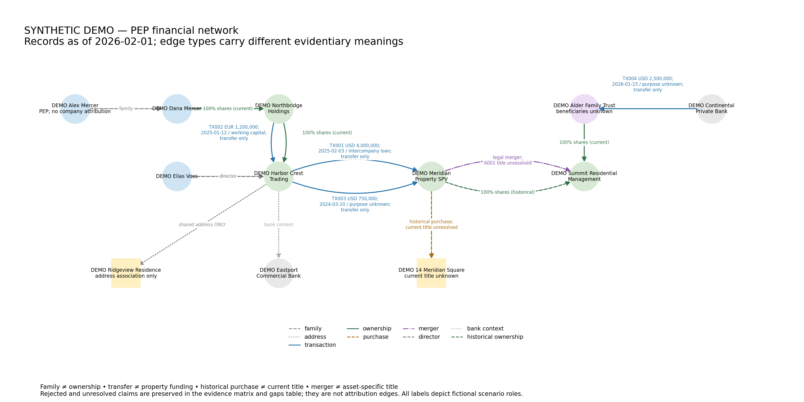

# PEP Financial Network OSINT

Employer portfolio brief | Jason Keen | Updated 2026-10-25

## Workflow and demonstration

PEP Financial Network OSINT
Employer portfolio brief
Jason Keen  |  Updated 2026-10-25  |  Synthetic portfolio
This portfolio demonstrates a reproducible financial-intelligence workflow using a fictional PEP, companies,
banks, transactions and assets. Its central result is an auditable record of what the evidence supports, what it
does not establish, and what additional collection is needed. The project is a worked implementation layer; it
does not claim universal methodology validity or formal operational intelligence experience.
The analytic question
Which entities, flows, assets and intermediaries can be linked, and what supports ownership, control, access,
benefit or mere association? Public-record networks can overstate attribution when different propositions are
collapsed into a single relationship. This demo keeps shareholding, family ties, directorship, payments, asset
association, succession and title separate.
The workflow
Requirements > entity resolution > ownership and control > transactions > asset linkage > corporate
succession and title > confidence and unknowns > collection gaps.
The requirements fix the question, evidence cutoff and synthetic scope. Entity resolution uses stable IDs and
registration keys; name similarity never merges records automatically. Dated relationships separate current
from historical shareholding. Transaction records retain currencies, purpose and bank context. Asset linkage
compares counterparties and timing, while title is assessed separately from legal succession. The validator
rejects a chronology-based funding inference if the transfer follows purchase or the payee is not the
purchaser. Every claim retains its sources, qualification, competing explanation and next evidence where
needed.
What the demonstration establishes
Dana Mercer is the documented shareholder of Northbridge Holdings. Alex Mercer is a family member, but
that relation does not establish his ownership. A USD 4.0 million intercompany loan reaches Meridian Property
SPV 17 days before its USD 5.5 million property purchase. The timing is compatible with a contribution to
acquisition liquidity; no record earmarks the transfer to the property. A later merger is documented, but current
asset-specific title and trust beneficiaries remain unresolved.
Outputs: a typed network graph, nine-claim evidence matrix, source register and dependency table, unresolved collection gaps,
validation reports and reproducible inputs.

## Evidence discipline and reproducibility

Evidence discipline and reproducibility
Confidence and open questions
The claims ledger distinguishes Confirmed, Strongly supported, Probable / analytic judgment, Alleged /
unverified, Unresolved and Rejected. Confidence is qualitative and specific to the proposition, not a legal
probability. Evidence maturity is separate: Established, Corroborated, Analytic or Open dependency;
Experimental is a reserved label with no scoring implementation.
S005 summarizes S004, so the two count as one documented source family rather than independent
corroboration. CL007 needs an asset-specific merger transfer schedule and post-merger title extract. CL009
needs a trust deed or verified beneficiary record. TX004 needs originating-account records to resolve the
economic source of funds. Rejected means unsupported on this bounded record, not disproven for all time.
Executed validation
Check
Recorded result
Automated tests
31 passed, including all 14 frozen controls
Clean synthetic inputs
0 errors; 1 expected derivative-context warning
Intentionally broken inputs
24 errors; validator exits 1; graph build refused
Generated artifacts
12 nodes; 14 edges; 9 claims; GraphML round-trip passed
Repeated local builds
Input hashes recorded; repeated output hashes match
Technical stack and limitations
Python, NetworkX, CSV and GraphML support a reproducible offline demo, with pinned dependencies, an
input SHA-256 manifest and automated GitHub checks. The validator checks IDs, temporal ownership,
currency aggregation, funding versus valuation, lineage, attribution and visible dependencies. The CI workflow
reruns these controls. A hostile self-review corrected misleading labels and evidence-link weaknesses; it was
not an independent audit.
All records are synthetic. Validation cannot authenticate documents, discover undisclosed copying, verify
foreign law or establish real-world beneficial ownership. No experimental weights or legal scores are used. A
purchase price is not current market value; offshore location and PEP status do not imply misconduct.
Skills demonstrated
Requirements framing, OSINT evidence qualification, due diligence, AML and financial-crime reasoning, entity
resolution, transaction analysis, network analysis, uncertainty management and reproducible research. The
portfolio shows how explicit evidence boundaries support a reviewable intelligence product and focused next
collection.
Implementation reference: jasonrkeen/pep-financial-network-osint (private; access controlled). Execution evidence:
outputs/test_results.txt, verification_summary.json and validation reports; interpretation: evidence_matrix.csv,
unresolved_gaps.csv and docs/red_team_review.md. MIT License, copyright 2026 Jason Keen. Public visibility remains blocked
until the owner gives final approval after release review.

## Complete synthetic network

The PDF contains the complete graph in a brief-sized vector layout. Family and address association do not establish ownership; payments do not prove funding; merger does not prove asset-specific title.

## License and publication

[MIT License](../LICENSE), copyright 2026 Jason Keen. [Implementation repository](https://github.com/jasonrkeen/pep-financial-network-osint) remains private pending the owner's final approval.
